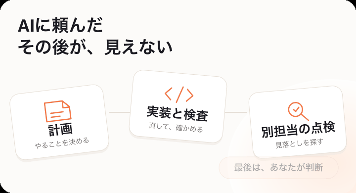
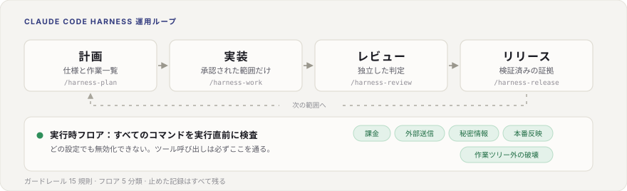

<p align="center"></p>


<h1 align="center">AIはコードを書く。<br>あなたは進捗と品質を追い続ける。</h1>

<p align="center"><a href="docs/images/readme/hero-motion-ja.svg"><picture><source media="(prefers-reduced-motion: reduce)" srcset="docs/images/readme/hero-motion-ja-poster.svg"></picture></a></p>

<p align="center"><strong>計画、検査、レビューまで任せる。<br>結果を見て、判断する。</strong></p>

普段のClaude Code、Codex CLI、Cursor、Grokと、そのアカウントを使えます。
[使っているAIから始める](#ツール別の導入) ／ [小さな仕事を試す](#最初に頼む仕事)

[English](README.md) | 日本語
[](https://github.com/Chachamaru127/claude-code-harness/releases/latest)

## 導入して始める

コーディング支援AIの導入とログインを済ませ、書き込みできるプロジェクトのフォルダを用意します。
既にHarnessを使っている場合は、再導入やファイル整理の前に[移行ガイド](docs/onboarding/migration.md)を確認してください。

Claude Codeを使う場合は、ターミナル（システムのコマンドを入力するアプリ）で起動します。

```bash
claude
```

続いて、**Claude Codeの会話内で**一行ずつ入力します。

```text
/plugin marketplace add Chachamaru127/claude-code-harness
/plugin install harness@claude-code-harness-marketplace
/harness-setup
```

`/harness-setup`は、プロジェクトで使う作業指示と検査を準備します。
提案された変更内容を確認してから受け入れます。
導入時間は、既存の設定と通信環境によって変わります。

Claude用のプラグインIDを`harness`に変更しました。
リポジトリ名と配布元のmarketplace名は同じです。
旧IDの`claude-code-harness`を導入済みなら、[既存のClaude環境の切替手順](docs/onboarding/plugin-rename_ja.md)を使います。
旧IDに更新コマンドを実行するだけでは、名前は切り替わりません。
ツールの一覧は確認済みの経路を示し、将来のすべての版を保証するものではありません。

別のAIを使う場合は、[ツール別の導入](#ツール別の導入)から選べます。
[導入ガイド](docs/onboarding/index.md)にも、最初の手順があります。

## 最初に頼む仕事

レビューは、実装とは別の担当による変更内容の点検です。
利用者が決めるのは、作りたい結果、完成条件、許可する操作です。


結果を自分で確かめられる、小さな変更から始めます。

```text
/harness-plan お問い合わせフォームの二重送信を直して。送信ボタンを素早く2回押しても、メッセージが1件だけ作られること。既存の入力項目と見た目は変えないで。
```

Harnessが`spec.md`と`Plans.md`を下書きします。
提案された動作、変更範囲、確認方法、未確認事項を読みます。
作業が始まる前に計画を承認するか、意図と違う部分を直します。

続いて入力します。

```text
/harness-work all
/harness-review
```

一つ目は承認済みの作業を進める依頼です。
二つ目は実装とは別の担当にレビューを頼む依頼です。
Codexでは、スラッシュの代わりに`$harness-plan`、`$harness-work all`、`$harness-review`を使います。

最後は、実際にフォームを試し、通った検査と未解決の問題を確かめます。
レビューできる変更でも、外部サービスとの接続や利用者の受け入れ確認が済むまでは公開できない場合があります。

## 何を任せられるか

| 説明をやり直す | 進み具合を追いかける | 「動いた」を確かめる |
|---|---|---|
| 仕様と計画をファイルに残す | 作業状態と判断待ちを見られる | 検査結果と別担当のレビューが返る |

## 作業の進め方

<p align="center"></p>

Harnessは`spec.md`に仕様を、`Plans.md`に作業項目を残します。
作業票と確認表を共有する仕組みに近いものです。
実際には、AIが下書きと記録の更新を行い、利用者が完成像を承認します。

**スキル**は、AIに渡す繰り返し使える作業手順です。
計画、実装、レビュー、状態確認、公開の5動詞スキルで進める、5動詞ワークフローです。
初期設定は別に行います。

| 依頼やコマンド | 返ってくるもの | 利用者が決めること |
|---|---|---|
| `/harness-plan` | 仕様、作業項目、完成条件、未確認事項、許可が必要な操作 | 範囲と完成条件の承認や修正 |
| `/harness-work 3` | 作業3の変更と必要な検査 | 新しい許可や製品判断が必要になった場合の回答 |
| `/harness-work all` | 承認済みの全作業と、その検査や修正 | 完成条件を満たしたかの判断 |
| `/harness-review` | 実装とは別の担当による指摘 | 重大な指摘は完了を止める。軽微な提案は残す場合がある |
| `/harness-sync` | 計画の記録と、確認したプロジェクトの状態との違い | 食い違いをどう直すか |
| `/harness-release` | 公開計画、版番号の変更案、公開のための検査 | 実行前に公開計画全体を承認するか |

テストを先に作る指定がある仕事では、修正前に失敗するテストを示し、修正後に再び実行します。
それ以外の仕事は、計画で求められた検査を行います。
文章の修正と決済機能の追加では、必要な検査が違います。

承認した範囲で戻せる仕事は、AIが続けます。
新しい許可や製品の判断が必要になると、その操作の手前で止まります。
検査の失敗や修正回数の上限に達した場合は、未完了として根拠と次の手順を返します。

## 進み具合と再開

| 画面 | 使うタイミング | 分かること |
|---|---|---|
| Plan Brief（計画の確認画面） | 計画の承認前 | 完成像、選択肢、リスク、完成条件 |
| Progress（進捗画面。`/harness-progress`） | 作業中 | `Plans.md`に記録された作業状態と判断待ち |
| Acceptance（受け入れ確認画面） | 公開前 | 完成条件ごとの合格、不合格、未確認 |

進捗率は、記録された作業項目の数で計算します。
機能が動くと証明できた割合ではありません。
例えば「10項目中8項目完了」でも、一連の操作を試す検査が失敗している場合があります。
Claude Codeでは、編集やコマンド実行の後に進捗画面を更新します。
更新は最大で60秒に1回です。
ほかのAIでは更新方法が異なります。

中断後は、次の依頼で再開できます。

```text
/harness-work --resume latest
```

記録された計画、変更、検査結果、残りの仕事を復元します。
何が復元されたかをAIに示してもらってから、続きを任せます。
任意の[harness-mem](https://github.com/Chachamaru127/harness-mem)を追加すると、会話をまたぐ記憶と検索も使えます。
基本の作業手順にharness-memは必須ではありません。

## 許可と制限

Harnessの実行フック（AIの操作前後に検査する接続口）につながる操作を確認します。
**Go ネイティブガードレールエンジン**は、その規則を適用する同梱プログラムです。
これを動かすためにNode.jsを入れる必要はありません。

| 検査の層 | 確認する操作 | 利用者が設定できる範囲 |
|---|---|---|
| 実行時フロア | 課金、外部送信、秘密の読み取り、本番への配備、作業コピーの外を壊す操作 | 操作の種類ごとに定めた個別の許可。全体を無効にするスイッチはない |
| ガードレール | 保護ファイル、共有するmainへの直接反映、強制反映、履歴の書き換え | 一部の規則をプロジェクトごとに設定できる |

事前承認できる操作は、計画と一緒に範囲を決めて許可できます。
許可できる内容は、操作の種類と設定された規則によって変わります。
AIが自分の検査を通すために保護設定を書き換えることは認めません。
止まった理由には規則と操作が記録され、原因を調べられます。

検査は、すべてのコマンドを隔離すると保証するものではありません。
確認できる範囲は、使うAIと操作の起動方法によって変わります。
Cursorには従来型のファイル操作の隔離がなく、Harness側で制限します。
Codexの標準の子エージェントは、親の操作権限を引き継ぐ場合があります。
Reviewerという役割名だけでは読み取り専用になりません。
companion reviewという別CLIを呼ぶ経路では、読み取り専用の実行を明示します。
機密を扱う仕事を任せる前に、[AIごとの検査範囲](docs/hardening-parity.md)と[Cursorの制限](docs/CURSOR_INTEGRATION.md)を確認してください。

## 費用とプロジェクトのデータ

HarnessはMITライセンスで、無償で利用や変更ができます。
コーディング支援AI、モデル提供会社、接続する外部サービスには、それぞれの料金と利用条件があります。
担当を増やしたり、レビューや再試行を繰り返したりすると、そのサービスの利用量が増える場合があります。
Harnessがアカウントや全サービス共通の課金上限を提供するわけではありません。

計画と作業記録は、プロジェクトのファイルに残ります。
実行状態は`.claude/state/`に保存します。
初期設定では、作業指示と検査用のファイルも追加します。
AIが読んだ内容には、そのAIサービスのデータ取り扱いが適用されます。
Harnessを入れても、モデルへの依頼がローカル処理になるわけではなく、提供会社へのデータ送信もなくなりません。
任意の記憶機能と外部接続は、別の設定とデータ範囲を持ちます。

## ツール別の導入

区分は、確認できたHarnessの連携範囲です。
`supported`は検証済みの導入経路、`internal-compatible`は制限付きの連携、`candidate`は試験段階です。
`future/unsupported`には、現在の利用者向け導入経路がありません。
同じ区分でも、権限や機能がすべて同じとは限りません。

| ツール | 区分 | 始め方、または不足しているもの |
|---|---|---|
| Claude Code | `supported` | 上の配布元登録と導入コマンドを実行し、`/harness-setup`を使う |
| Codex CLI | `supported` | [`scripts/setup-codex.sh --user`を実行](codex/README.md#option-1-script-recommended-user-based)してCodexを再起動 |
| Cursor | `supported` | `scripts/setup-cursor.sh`を実行してCursorを再読み込み。上の権限制限を確認 |
| Grok | `supported` | `scripts/setup-grok.sh`を実行して新しい会話を開始 |
| OpenCode | `internal-compatible` | `scripts/setup-opencode.sh`で指示とスキルを導入。実行時の動作が全体で同等とは未確認 |
| Codex app | `candidate` | Codex CLIの導入実績から、アプリ版の導入方法までは確認できない |
| Hermes Agent | `candidate` | 手動のスキル読み込みを試験中。操作を自動で制限する接続は未実装 |
| GitHub Copilot CLI | `candidate` | 手動の指示を試験中。Harnessの検証済み導入経路はない |
| Antigravity CLI | `future/unsupported` | 利用者向けの導入経路はない |

設定スクリプトを使う場合は、Git（プロジェクトの版を管理するプログラム）で、このリポジトリを取得します。

```bash
git clone https://github.com/Chachamaru127/claude-code-harness.git
cd claude-code-harness
```

続いて、使うAIの設定スクリプトを実行します。
Codexの`--user`導入は、利用者共通のスキル、規則、管理対象の設定を書き込みます。
複数のプロジェクトに適用されます。
既存の`worker.toml`と`reviewer.toml`は、利用者が作ったものでも控えを取って置き換えます。
プロジェクト単位の導入、更新、取り外しは[導入の詳細](docs/onboarding/install.md)で確認できます。

## 大きい仕事とモデルの選択

`/breezing`は、大きい承認済みの仕事を複数の担当へ分けます。
`/harness-loop`は上限回数まで仕事を繰り返し、必要なら相談役を呼びます。
既定の上限は8回です。
上限に達することと、仕事の完了は別です。
`/harness-loop status`で状態を見て、`/harness-loop stop`で次の実行を止められます。

利用者が明示したモデルと推論量は、それが指定された実行経路で優先します。
推論量は、モデルが考えるために使う処理の量です。
主会話の設定を変えても、すべての子エージェントの設定が変わるわけではありません。
変更前に[役割別のモデル設定](docs/model-routing-policy.md)と[Codex Breezingの担当設定](codex/README.md#codex-breezing-role-routing)を確認できます。

試験機能の`HARNESS_AUTO_APPROVE=on`は、利用条件の確認結果を記録するだけです。
既定では無効です。
有効にしても承認の質問は省略しません。

## 更新と困ったとき

Claude Codeでは、会話内で実行します。

```text
/plugin update harness
/harness-setup
```

スクリプトで導入した場合は、取得したリポジトリで`git pull --ff-only`を実行します。
同じ設定スクリプトを再実行し、AIを再起動または再読み込みします。
更新前に[日本語の変更履歴](CHANGELOG_ja.md)か[英語の変更履歴](CHANGELOG.md)で、動作の変更と必要な操作を確認してください。

コマンドが見つからなければ、使っているAIを対象に導入したか、再起動したかを確認します。
[導入の確認手順](docs/onboarding/skill-trigger-acceptance.md)で、最初の呼び出しが成功した状態を確かめられます。
取得したHarnessのリポジトリで`bin/harness doctor --migration-report`を実行すると、古い設定ファイルと記憶機能の状態を調べられます。
この確認ではファイルを削除しません。

検査で止まった場合は、エラーの全文を残します。
AIに規則、対象、必要な許可を説明してもらいます。
検査に失敗した仕事を、完了として扱わないでください。
再現する導入や実行の問題は、[GitHub Issues](https://github.com/Chachamaru127/claude-code-harness/issues)へ報告できます。

## 動作要件

CLIは、ターミナルから使う版を指します。
リポジトリは、Gitで変更履歴を管理するプロジェクトのフォルダです。


- 導入済みのコーディング支援AIと、そのアカウントまたはモデル提供会社へのアクセス。
- Claude Codeの経路ではv2.1以上。[互換性の記録](docs/CLAUDE_CODE_COMPATIBILITY.md)で、確認した日時と環境ごとの制限を確認できる。
- 書き込みできるプロジェクトのリポジトリ。設定スクリプトにはGitと、それを実行できるシェルが必要。
- 同梱の実行ファイルを使う場合、Goの導入は不要。現在のソースから作る場合はGo 1.26.0以上が必要。任意のスキルには追加要件がある場合がある。

## ドキュメント

- [使っているAIから始める](docs/onboarding/index.md)、[導入と取り外し](docs/onboarding/install.md)、[既存利用者の移行](docs/onboarding/migration.md)。
- [表示言語の設定](docs/i18n.md)：配布時の既定言語は English（英語）。「以後は日本語で返答して」と依頼すれば会話を切り替えられる。プロジェクト設定と環境変数でも指定できる。
- [導入されるファイル](docs/distribution-scope.md)と[全作業の検査基準](docs/evidence/work-all.md)。
- [日本語の製品ガイド](docs/reports/2026-09-06-cch-product-guide-v5.15.0.html)。

プロジェクトで言語を指定していない場合は、起動時にも選べます。

```bash
CLAUDE_CODE_HARNESS_LANG=ja claude
```

プロジェクトの言語指定がある場合は、その設定が環境変数より優先します。
会話内の明示的な言語指定は、両方より優先します。

## コントリビュート

期待した動作、実際の動作、再現手順をIssueへ記載してください。
変更を提案する場合は[CONTRIBUTING.md](CONTRIBUTING.md)を確認できます。

## 謝辞

[AI Masao](https://note.com/masa_wunder)のスキル整理の考え方と、[Beagle](https://github.com/beagleworks)のテスト保護の方法を参考にしています。

## ライセンス

[MIT](LICENSE.md)。
