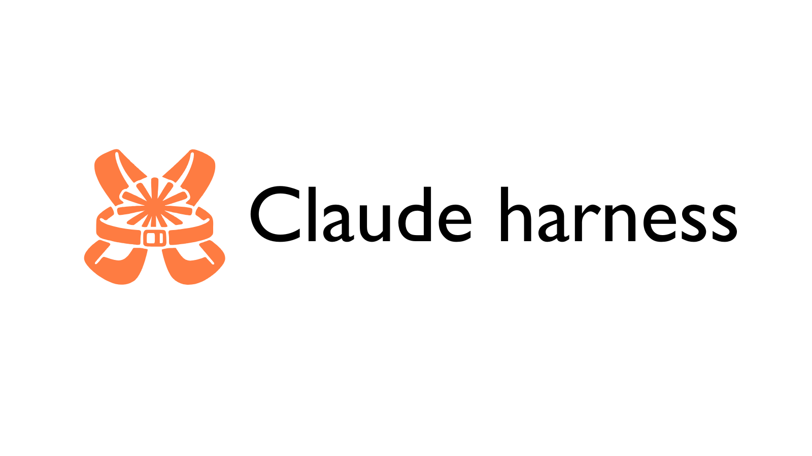
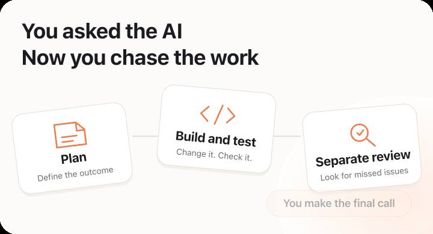
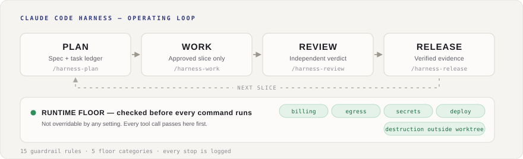

<p align="center"></p>


<h1 align="center">AI负责写代码。<br>你负责跟进进度和质量。</h1>

<p align="center"><a href="docs/images/readme/hero-motion-en.svg"><picture><source media="(prefers-reduced-motion: reduce)" srcset="docs/images/readme/hero-motion-en-poster.svg"></picture></a></p>

<p align="center"><strong>把计划、检查、审查都交给它。<br>你只管看结果、做判断。</strong></p>

你现有的 Claude Code、Codex CLI、Cursor、Grok 及其账号都可以使用。
[从你用的AI开始](#工具别的引入方式) ／ [先试个小任务](#最先委托的工作)

[English](README.md) | 日本語
[](https://github.com/Chachamaru127/claude-code-harness/releases/latest)

## 安装并开始使用

完成编码辅助AI的安装和登录，准备一个可写入的项目文件夹。
如果你已经在使用 Harness，在重新安装或整理文件之前请先查看[迁移指南](docs-zh/onboarding/migration.md)。

使用 Claude Code 时，在终端（输入系统命令的应用）中启动。

```bash
claude
```

然后，**在 Claude Code 的对话内**逐行输入。

```text
/plugin marketplace add Chachamaru127/claude-code-harness
/plugin install harness@claude-code-harness-marketplace
/harness-setup
```

`/harness-setup` 会准备项目中使用的作业指示和检查。
请在确认提案的变更内容后再接受。
安装时间因现有设置和网络环境而异。

Claude 用插件 ID 已改为 `harness`。
仓库名和分发 marketplace 名相同。
如果已安装旧 ID `claude-code-harness`，请使用[现有 Claude 环境的切换步骤](docs-zh/onboarding/plugin-rename_ja.md)。
仅对旧 ID 执行更新命令，名称不会切换。
工具列表显示的是已确认的路径，不保证支持所有未来版本。

要使用其他 AI，请从[工具别的引入方式](#工具别的引入方式)中选择。
[安装指南](docs-zh/onboarding/index.md)也有最初的操作步骤。

## 最先委托的工作

审查是由与实现不同的负责人对变更内容进行的检查。
由用户决定的是：想要的结果、完成条件、允许的操作。


从自己能验证结果的小改动开始。

```text
/harness-plan 修复表单重复提交的问题。快速按两次提交按钮也只创建一条消息。不要改变现有的输入项和外观。
```

Harness 会起草 `spec.md` 和 `Plans.md`。
阅读提案的运行方式、变更范围、验证方法、待确认事项。
在作业开始前批准计划，或修正与意图不符的部分。

然后继续输入。

```text
/harness-work all
/harness-review
```

第一个是推进已批准作业的委托。
第二个是委托与实现不同的负责人进行审查的委托。
在 Codex 中，使用 `$harness-plan`、`$harness-work all`、`$harness-review` 代替斜杠命令。

最后实际测试表单，确认通过的检查和未解决的问题。
即使是可审查的变更，有时在外部服务连接或用户验收确认完成之前也无法发布。

## 能委托什么

| 重新说明内容 | 追踪进展 | 确认"能动了" |
|---|---|---|
| 将规格和计划记录在文件中 | 可以查看作业状态和待判断项 | 返回检查结果和另一负责人的审查 |

## 作业的推进方式

<p align="center"></p>

Harness 将规格留在 `spec.md`，将作业项留在 `Plans.md`。
这类似于共享工单和检查表的方式。
实际上由 AI 起草和更新记录，用户批准最终方案。

**Skill** 是可重复使用的作业步骤，交给 AI。
由计划、实现、审查、状态确认、发布这 5 个动词 skill 推进的 5 动词工作流。
初始设置另行进行。

| 委托或命令 | 返回的内容 | 由用户决定的事项 |
|---|---|---|
| `/harness-plan` | 规格、作业项、完成条件、待确认事项、需要批准的操作 | 批准或修改范围与完成条件 |
| `/harness-work 3` | 作业 3 的变更及所需检查 | 回答需要新许可或产品判断的情况 |
| `/harness-work all` | 已批准的全部作业及其检查和修正 | 判断是否满足完成条件 |
| `/harness-review` | 来自与实现不同负责人的意见 | 重大意见会阻止完成。轻微建议有时会保留 |
| `/harness-sync` | 计划的记录与确认的项目状态之间的差异 | 如何修复不一致 |
| `/harness-release` | 发布计划、版本号变更方案、发布前的检查 | 执行前批准整个发布计划 |

有指定先创建测试的工作，会在修改前显示失败的测试，修改后再次运行。
其他工作则执行计划中要求的检查。
文档修改和支付功能添加所需的检查不同。

AI 会继续执行在批准范围内可回退的工作。
当需要新的许可或产品判断时，会在该操作前停止。
当检查失败或修正次数达到上限时，作为未完成状态返回依据和后续步骤。

## 进展情况和恢复

| 画面 | 使用时机 | 能了解的信息 |
|---|---|---|
| Plan Brief（计划确认画面） | 批准计划前 | 最终方案、选项、风险、完成条件 |
| Progress（进度画面。`/harness-progress`） | 作业中 | 记录在 `Plans.md` 中的作业状态和待判断项 |
| Acceptance（验收确认画面） | 发布前 | 每个完成条件的合格、不合格、未确认 |

进度率根据记录的作业项数量计算。
不是已证明功能可动的比例。
例如"10项中完成8项"的情况下，验证一系列操作的检查可能失败。
在 Claude Code 中，会在编辑或命令执行后更新进度画面。
更新最多每 60 秒一次。
其他 AI 的更新方式不同。

中断后可通过下一个委托恢复。

```text
/harness-work --resume latest
```

恢复记录的计划、变更、检查结果和剩余工作。
请 AI 显示恢复了什么内容，然后再继续委托。
添加可选的 [harness-mem](https://github.com/Chachamaru127/harness-mem) 后，还可以跨会话使用记忆和搜索。
基本作业步骤不要求必须使用 harness-mem。

## 许可和限制

确认与 Harness 执行 hook（连接口，在 AI 操作前后进行检查）相关的操作。
**Go 原生 guardrail 引擎** 是应用这些规则的配套程序。
运行它不需要安装 Node.js。

| 检查层 | 确认的操作 | 用户可设置的范围 |
|---|---|---|
| 运行时 floor | 计费、外部发送、秘密读取、部署到生产环境、破坏作业副本以外的操作 | 按操作类型设置的个别许可。没有关闭整体的开关 |
| Guardrail | 保护文件、直接反映到共享 main、强制反映、重写历史 | 部分规则可按项目设置 |

可预先批准的操作，可以在计划中确定范围后许可。
可许可的内容因操作类型和设置的规则而异。
不允许 AI 为了通过自己的检查而修改保护设置。
停止原因会记录规则和操作，可以调查原因。

检查并不能保证所有命令都被隔离。
可确认的范围因使用的 AI 和操作启动方式而异。
Cursor 没有传统型的文件操作隔离，由 Harness 侧进行限制。
Codex 的标准子代理有时会继承父级的操作权限。
仅凭 Reviewer 这个角色名不会变成只读。
在调用 companion review 这个其他 CLI 的路径上，会明确指定只读执行。
在委托涉及机密的工作之前，请确认[各 AI 的检查范围](docs-zh/hardening-parity.md)和 [Cursor 的限制](docs/CURSOR_INTEGRATION.md)。

## 费用和项目数据

Harness 采用 MIT 许可证，可免费使用和修改。
编码辅助 AI、模型提供商、连接的外部服务各有其收费和使用条件。
增加负责人或重复审查和重试会增加该服务的使用量。
Harness 不提供账户和跨服务共用的计费上限。

计划和作业记录留在项目文件中。
执行状态保存在 `.claude/state/` 中。
默认还会添加作业指示和检查用的文件。
AI 读取的内容适用该 AI 服务的数据处理方式。
安装 Harness 不会使对模型的请求变为本地处理，也不会消除向提供商发送数据。
可选的记忆功能和外部连接具有各自不同的设置和数据范围。

## 工具别的引入方式

分类是已确认的 Harness 联动范围。
`supported` 是已验证的安装路径，`internal-compatible` 是有限制的联动，`candidate` 是试验阶段。
`future/unsupported` 目前没有面向用户的安装路径。
即使在同一分类中，权限和功能也不一定完全相同。

| 工具 | 分类 | 开始方法，或不足之处 |
|---|---|---|
| Claude Code | `supported` | 执行上面的 marketplace 注册和安装命令，使用 `/harness-setup` |
| Codex CLI | `supported` | [执行 `scripts/setup-codex.sh --user`](codex/README.md#option-1-script-recommended-user-based) 后重启 Codex |
| Cursor | `supported` | 执行 `scripts/setup-cursor.sh` 后重新加载 Cursor。请确认上面的权限制限 |
| Grok | `supported` | 执行 `scripts/setup-grok.sh` 后开始新会话 |
| OpenCode | `internal-compatible` | 用 `scripts/setup-opencode.sh` 引入指示和 skill。执行时的整体行为是否等效尚未确认 |
| Codex app | `candidate` | 从 Codex CLI 的安装实践来看，无法确认到 app 版的安装方法 |
| Hermes Agent | `candidate` | 正在试验手动加载 skill。尚未实现自动限制操作的联动 |
| GitHub Copilot CLI | `candidate` | 正在试验手动指示。没有 Harness 的已验证安装路径 |
| Antigravity CLI | `future/unsupported` | 没有面向用户的安装路径 |

使用设置脚本时，用 Git（管理项目版本管理的程序）获取本仓库。

```bash
git clone https://github.com/Chachamaru127/claude-code-harness.git
cd claude-code-harness
```

然后执行所用 AI 的设置脚本。
Codex 的 `--user` 安装会写入用户共同的 skill、规则和管理对象的设置。
适用于多个项目。
现有的 `worker.toml` 和 `reviewer.toml` 即使用户自己创建的也要备份后再替换。
按项目的安装、更新、拆卸可在[安装详情](docs-zh/onboarding/install.md)中确认。

## 大工作和模型选择

`/breezing` 将大的已批准工作分配给多个负责人。
`/harness-loop` 最多重复指定次数，必要时调用咨询角色。
默认上限是 8 次。
达到上限和完成工作是两回事。
用 `/harness-loop status` 查看状态，用 `/harness-loop stop` 停止下次执行。

用户明确指定的模型和推理量，在该指定执行路径中优先。
推理量是模型用于思考的处理量。
改变主会话的设置不一定会改变所有子代理的设置。
可在变更前确认[各角色的模型设置](docs-zh/model-routing-policy.md)和 [Codex Breezing 的负责人设置](codex/README.md#codex-breezing-role-routing)。

试验功能 `HARNESS_AUTO_APPROVE=on` 仅记录使用条件确认结果。
默认禁用。
即使启用也不会省略确认提问。

## 更新和遇到问题时

在 Claude Code 中，在对话内执行。

```text
/plugin update harness
/harness-setup
```

用脚本安装时，在获取的仓库中执行 `git pull --ff-only`。
重新执行相同的设置脚本，重启或重新加载 AI。
更新前请在[日语变更日志](CHANGELOG_zh.md)或[英语变更日志](CHANGELOG.md)中确认行为变更和必要的操作。

如果找不到命令，请确认是否针对所用的 AI 进行了安装和重启。
可以在[安装确认步骤](docs/onboarding/skill-trigger-acceptance.md)中确认首次调用成功的状态。
在获取的 Harness 仓库中执行 `bin/harness doctor --migration-report` 可以检查旧设置文件和记忆功能的状态。
此确认不会删除文件。

如果在检查中停止，请保留错误全文。
请 AI 说明规则、对象和必要的许可。
不要将检查失败的工作视为已完成。
可重现的安装或执行问题可以报告到 [GitHub Issues](https://github.com/Chachamaru127/claude-code-harness/issues)。

## 运行要求

CLI 是指从终端使用的版本。
仓库是用 Git 管理变更历史的项目文件夹。


- 已安装的编码辅助 AI 及其账户或模型提供商的访问权限。
- Claude Code 路径要求 v2.1 以上。可以在[兼容性记录](docs/CLAUDE_CODE_COMPATIBILITY.md)中确认确认日期和各环境限制。
- 可写入的项目仓库。设置脚本需要 Git 和可执行它的 shell。
- 使用附带的可执行文件时不需要安装 Go。从当前源码构建需要 Go 1.26.0 以上。某些可选 skill 可能有额外要求。

## 文档

- [从所用的 AI 开始](docs-zh/onboarding/index.md)、[安装和拆卸](docs-zh/onboarding/install.md)、[现有用户的迁移](docs-zh/onboarding/migration.md)。
- [显示语言设置](docs-zh/i18n.md)：分发的默认语言是 English（英语）。只要委托"以后用日语回复"就可以切换会话。也可以在项目设置和环境变量中指定。

项目的语言设置优先于环境变量。
对话内的明确语言指定优先于两者。

## 贡献

请在 Issue 中记录期望的行为、实际的行为、重现步骤。
如要提出变更建议可查看 [CONTRIBUTING.md](CONTRIBUTING.md)。

## 致谢

参考了 [AI Masao](https://note.com/masa_wunder) 的 skill 整理思路和 [Beagle](https://github.com/beagleworks) 的测试保护方法。

## 许可证

[MIT](LICENSE.zh.md)。
