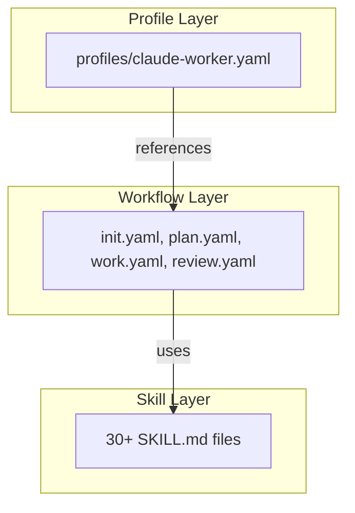

# Claude Harness 架构

## 1. 概要

`claude-code-harness` 是一个模块化的自主开发框架，旨在最大限度地发挥 Claude Code 的能力。核心设计理念是通过 **Skills**、**Rules**、**Hooks** 三个主要扩展功能来支持 **Plan → Work → Review** 这一体系化的开发周期。

## 2. 3 层架构

该插件采用以下 3 层架构，以提高复用性和可维护性。



- **Skill Layer**：定义为 `SKILL.md` 文件的独立知识单元。包含执行特定任务（例如：安全审查、代码实现）的具体步骤和知识。
- **Workflow Layer**：定义为 `*.yaml` 文件，负责编排执行特定开发阶段（例如：`/work`）所需的 **Skills**。管理步骤顺序、条件分支、错误处理等。
- **Profile Layer**：定义插件整体行为。指定将哪些工作流分配给哪些命令、允许哪些 Skill 类别等。

## 3. 目录结构

```
claude-code-harness/
├── .claude-plugin/         # プラグインメタデータ
│   ├── plugin.json
│   └── hooks.json
├── skills/                 # Skill定義 (SKILL.md + references/)
│   ├── impl/               # 実装スキル
│   ├── harness-review/     # レビュースキル
│   ├── verify/             # 検証スキル
│   ├── planning/           # プランニングスキル
│   ├── setup/              # セットアップスキル
│   ├── ci/                 # CI/CD関連スキル
│   └── ...                 # その他30+スキル
├── agents/                 # サブエージェント定義 (Markdown)
├── hooks/                  # Hooks定義 (hooks.json)
├── scripts/                # 自動化用シェルスクリプト
├── docs/                   # ドキュメント
└── templates/              # 各種テンプレート
```

## 4. 主要组件

### 4.1. Skills

每个 Skill 通过明确标注 `description`（何时使用）和 `allowed-tools`（允许使用的工具），支持 Claude 进行自主发现和安全执行。

### 4.2. Rules

通过 `claude-code-harness.config.schema.json` 严格定义配置文件，强制执行安全性（`dry-run` 模式）和路径限制（`protected` 路径）。

### 4.3. Hooks

在 `hooks.json` 中定义，在开发过程的关键节点自动执行脚本。
- **SessionStart**：会话开始时的环境检查
- **PostToolUse**：文件编辑后的自动测试和变更追踪
- **Stop**：会话结束时的摘要生成

### 4.4. 并行处理

在 `/harness-review` 命令中，同时启动多个 `code-reviewer` 子代理，并行执行安全、性能、质量审查，从而大幅缩短反馈时间。
